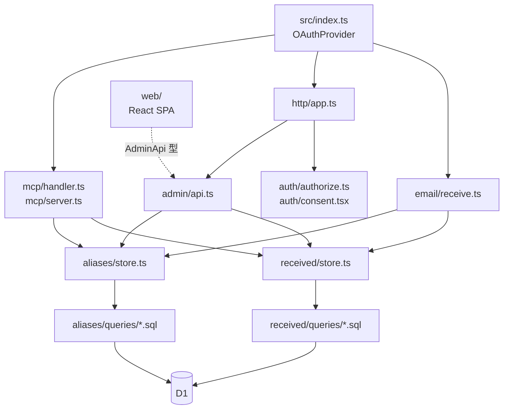

# AGENTS.md

概要とセットアップは README.md を参照。

## コマンド

タスクは `vite.config.ts` の `run.tasks` に定義している。`vp check` / `vp test` / `vp build` は Vite+ の組み込みコマンドなので、必ず `vp run` 経由で実行する。

```sh
vp run check            # フォーマット・Lint・型検査（変更後は必ず通す）
vp run test             # 単体テスト（型は検査しない）
vp run test:e2e         # cf dev を起動する E2E テスト
```

Cloudflare の操作には `wrangler` ではなく `cf` CLI を使う。

## 構成



- SQL を扱う境界はエイリアスの `src/aliases/store.ts` と受信履歴の `src/received/store.ts` だけ。MCP・管理 API・メール受信はすべてこの store を使う。
- SQL は各ディレクトリの `queries/*.sql` に置き、Reylo が型を推論する。スキーマ変更は `migrations/` に追加する。Reylo は SQLite の CHECK 制約から union を推論しないため、そうした列は `queries.ts` で Zod により検証する。
- 入力のスキーマは Zod で `src/aliases/schema.ts`・`src/received/schema.ts` に置く。検証ライブラリへの依存は `src/http/validate.ts` に閉じる。
- ドメイン・表示名・テーマカラーは `app.config.ts`、デプロイ先は `deploy.config.ts` に置く。`cloudflare.config.ts` の依存は開発サーバーから読めないため、Worker が読む設定を `deploy.config.ts` 側に入れない。コードに直接書かず、`src/config.ts` の `MAIL_DOMAIN`・`APP_NAME` などを使う。本番のドメインはリポジトリに載せず、ビルド時の環境変数 `MAIL_DOMAIN` で渡す（`vite.config.ts` の `define`）。単体テストのドメインは `src/test/setup.ts` で `mail.example.test` に固定している。
- 管理画面（`src/web/`）は `src/admin/api.ts` の `AdminApi` 型を `hono/client` に渡して型を共有する。
- 管理画面の UI は Mantine のコンポーネントと style props、`theme.ts` で作る。独自 CSS・外部フォントは使わない。

## 型安全

- `any`・型アサーション（`as`）・non-null アサーション（`!`）は禁止（`as const` は可）。
- 例外は `src/aliases/queries.ts`・`src/received/queries.ts` と各 `store.test-d.ts` のみ。tsgolint は `.sql` の import を解決できないため、queries の外向きの型を明示し、Reylo の推論との一致を `store.test-d.ts` で検査する。
- TypeScript 7.1 Beta、`cf`、Cloudflare Vite plugin はバージョンを固定している。勝手に上げない。

## テスト

- テストは実装の隣に置く。単体テストは `*.test.ts`、cf dev を起動する E2E テストは `*.spec.ts`（共通の起動処理は `src/test/e2e/`）、型テストは `*.test-d.ts`。
- API は `vite-plus/test` から明示的に import する。
- DB・MCP 接続・モックは `test.extend` の fixture でテストごとに作り、解放は `onCleanup` に登録する。fixture を使うパラメーター化テストは `test.for` を使う。
- 非同期の assertion は必ず `await` する。待機は固定 sleep ではなく `vi.waitUntil` を使う（`vi` を使えない E2E の globalSetup だけはポーリングで待つ）。
- store・メール受信・MCP ツールは実際の SQLite（`src/test/fixtures.ts` の `dbTest`）で検証する。MCP の HTTP ハンドラーのテストでは store をモックする。
- レスポンスや `structuredContent` は型アサーションではなく Zod のスキーマで parse する。

## 注意

- 一文だけのコメントは文末に「。」を付けない。
- 転送エラーや DB の参照失敗は握りつぶさず、Worker の失敗として扱う。例外は転送した後の受信履歴の記録で、再送による二重の転送を避けるためログに残して成功として扱う。
- 本番 D1 へのマイグレーションやデプロイは、指示がない限り実行しない。通常は GitHub Release を公開して、Deploy ワークフローで行う。
- マイグレーションはデプロイの前に適用されるため、旧コードが動いたままでも壊れない変更（列・テーブルの追加など）に限る。
