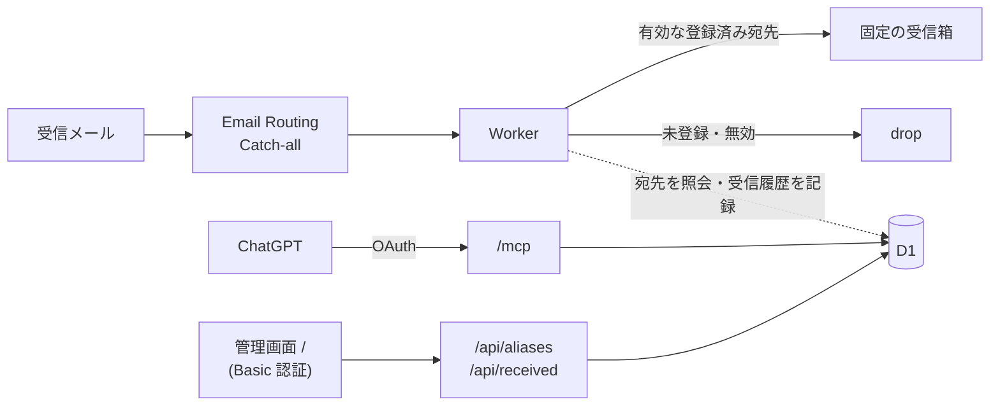

# Email Aliases

独自ドメインの Catch-all アドレス（`*@mail.example.com`）の受信許可リストを管理する、個人用の MCP サーバー。
ドメイン・表示名・テーマカラーは `app.config.ts`、デプロイ先は `deploy.config.ts` で変更できる。ドメインはビルド時の環境変数 `MAIL_DOMAIN` でも上書きでき、リポジトリに載せずに済む。



Cloudflare Workers / D1 / KV（OAuth 用）/ Hono / React / Mantine / Reylo / Vite+

## エントリーポイント

Worker は `fetch`（HTTP）と `email`（Email Routing）の 2 つのハンドラーを持つ。

| 入口                    | 認証  | 内容                                                     |
| ----------------------- | ----- | -------------------------------------------------------- |
| `email` ハンドラー      | なし  | Catch-all で受けたメールを転送または drop し、履歴に記録 |
| `/mcp`                  | OAuth | MCP（Streamable HTTP、ステートレス）                     |
| `/.well-known/oauth-*`  | なし  | OAuth のメタデータ（OAuthProvider が自動で返す）         |
| `/oauth/register`       | なし  | クライアント登録（DCR）                                  |
| `/oauth/token`          | なし  | トークン発行・更新                                       |
| `/authorize`            | Basic | 接続承認ページ                                           |
| `/`                     | Basic | 管理画面（React SPA）                                    |
| `/api/aliases`          | Basic | 管理 API（GET・POST・PATCH・DELETE）                     |
| `/api/aliases/disabled` | Basic | 管理 API（PUT で有効・無効を切り替え）                   |
| `/api/received`         | Basic | 受信履歴（GET で一覧、DELETE で 1 件削除）               |
| `/api/received/clear`   | Basic | 受信履歴（POST で絞り込みに一致する行を削除）            |
| `/health`               | なし  | 死活確認                                                 |

## MCP ツール

| ツール                  | 入力                                                         | 動作                                                                                              |
| ----------------------- | ------------------------------------------------------------ | ------------------------------------------------------------------------------------------------- |
| `create_alias`          | `address`, `note?`, `service_url?`                           | 受信を許可。既存アドレスは変更しない                                                              |
| `list_aliases`          | `query?`, `status?`, `has_service_url?`, `limit?`, `offset?` | 一覧・検索。`query` はアドレス・メモ・URL の部分一致。`next_offset` で次ページ                    |
| `delete_alias`          | `address`                                                    | 登録を削除。以後のメールを drop                                                                   |
| `set_alias_disabled`    | `address`, `disabled`                                        | 転送の停止・再開。登録情報は保持                                                                  |
| `update_alias_details`  | `address`, `note?`, `service_url?`                           | メモ・サービス URL を編集。省略項目は保持、空文字で消去                                           |
| `list_received_emails`  | `filter?`, `limit?`, `offset?`                               | 受信履歴を新しい順に一覧。`filter` で結果を絞り込む                                               |
| `delete_received_email` | `id`                                                         | 受信履歴を 1 件削除                                                                               |
| `clear_received_emails` | `filter`                                                     | 絞り込みに一致する受信履歴をまとめて削除                                                          |
| `list_alias_activity`   | `sort?`, `limit?`, `offset?`                                 | エイリアスごとの最終受信・直近 30 日と 180 日の受信件数。使われていないものや受信の多いものを探す |

- `address` は `shopping@mail.example.com` のような完全なアドレス。完全一致で判定するため `shopping+news` は別扱い。
- ローカルパートは ASCII のドット区切り（最大 64 文字）のみ。`*` は使えない。
- 転送先は全アドレス共通の `FORWARD_TO`。

## 受信履歴

自ドメイン宛てに届いたメールを、転送したかどうかにかかわらず記録する。管理画面の「受信履歴」タブで、ドロップしたものに絞って登録漏れを確認し、そのままエイリアスとして登録できる。

- 記録するのは受信日時・宛先・送信元（エンベロープの From、320 文字まで）・サイズ・結果。件名や本文は保存しない。
- 結果は `forwarded`（転送）・`disabled`（無効なエイリアス宛てで drop）・`unknown`（未登録の宛先で drop）。`filter` の `dropped` は後ろの 2 つをまとめたもの。
- 自ドメイン以外や形式が不正な宛先は記録しない。
- 未登録の宛先は攻撃に使われやすいため、直近 1 時間に新しい宛先が 10 件、または未登録宛ての受信が 100 件に達すると、それ以降は記録せずに drop する。
- 180 日を過ぎた履歴は、受信のたびに D1 のトリガーが削除する。
- 転送した後に記録が失敗しても、メールは転送済みなのでログに残すだけにする（Worker を失敗させると再送で二重に転送されうるため）。

## ローカル開発

Node.js 24 以降と pnpm 10 が必要。

```sh
pnpm install
vp run secrets:dev               # 1Password から .dev.vars を作る（使わない場合は .dev.vars.tpl をコピーして値を書く）
vp run db:migrate:local
vp run dev                       # http://localhost:5173（ユーザー名 admin）
```

```sh
vp run check            # フォーマット・Lint・型検査
vp run test             # 単体テスト
vp run test:e2e         # cf dev を起動する E2E テスト
vp run build
```

タスクは `vite.config.ts` に定義している。`vp` が PATH にない場合は `pnpm exec vp run <タスク名>`。

### 開発メモ

- SQL は `src/aliases/queries/*.sql` と `src/received/queries/*.sql` に置き、Reylo が型を推論する。そのため TypeScript 7.1 Beta を固定している。
- `any`・`as`・`!` は lint で禁止。例外は Reylo の型を受け取る `src/aliases/queries.ts`・`src/received/queries.ts` のみで、型の一致は各 `store.test-d.ts` で検査する。
- VS Code で `.sql` の import が解決できない場合は、拡張 **TypeScript 7**（`TypeScriptTeam.native-preview`）でワークスペースの TypeScript を使う。それでも駄目なら Node 24 で VS Code を起動し直す（`mise exec node@24.14.0 -- code .`）。

## 本番への配置

1. D1 と KV を作成する。

   ```sh
   pnpm exec cf auth login
   pnpm exec cf d1 create --name email-aliases
   pnpm exec cf kv namespaces create --title email-aliases-oauth
   ```

2. `app.config.ts` と `deploy.config.ts` を自分の環境に合わせて編集する。

3. マイグレーションを適用する（DB 名ではなく database ID を指定）。

   ```sh
   pnpm exec cf d1 migrations apply <database-id>
   ```

4. 本番用の値を 1Password の `Production` 保管庫の Login アイテム `email-aliases` に置き、デプロイする（値は Worker Secrets としてアップロードされる）。
   ユーザー名は `admin`、パスワードは `ADMIN_PASSWORD`、ウェブサイトは公開 URL、カスタムフィールド `FORWARD_TO` は転送先、`MAIL_DOMAIN` はメールのドメインにする。`MAIL_DOMAIN` は Secret ではなく、ビルド時に埋め込む。ローカル用は `Development` 保管庫に同じ形で置く。
   項目は `.prod.vars.tpl` のとおり。公開 URL（`PUBLIC_ORIGIN`、末尾 `/` なし）もリポジトリに載せないよう、ここに置く。
   `FORWARD_TO` は Email Routing で確認済みのアドレスにする。

   ```sh
   vp run deploy:prod
   ```

   1Password を使わない場合は、`.prod.vars.tpl` をコミットされない `.prod.vars` にコピーして値を書き、`MAIL_DOMAIN=<ドメイン> vp run deploy --secrets-file .prod.vars` でデプロイする（`app.config.ts` にドメインを書いた場合は `MAIL_DOMAIN` は不要）。

5. ChatGPT から接続し、使用中のアドレスを **先に** `create_alias` で登録する。

6. Email Routing でメールのドメインの Catch-all の転送先をこの Worker に変更する。切り替え後、D1 にない宛先はすべて drop される。

## CI/CD（GitHub Actions）

- **CI**（`.github/workflows/ci.yml`）：PR と main への push で、`vp run check`・`vp run test`・`vp run test:e2e` を実行する。
- **Deploy**（`.github/workflows/deploy.yml`）：Actions タブの「Run workflow」から手動で実行する。main からのみ実行でき、次の順に進む。
  1. check と単体テスト
  2. 本番 D1 へのマイグレーション（`vp run db:migrate:prod`）
  3. デプロイ（`vp run deploy:prod`）

Action の依存は [ワークフローの lockfile](https://gh.io/actions-lockfile)（`.github/workflows/actions.lock`、public preview）でコミットに固定している。`uses:` はタグで書き、変更したら lockfile を作り直す。CI の `Verify actions.lock` が、lockfile とワークフローが一致しているかを検査する。Dependabot が Action を更新するときは、lockfile も同じ PR で更新される。

```sh
gh extension install github/gh-actions-lock
gh actions-lock          # uses: を変えた後に実行する
```

ローカルの composite action は `uses: $/.github/actions/...` で参照する（`./` だと lockfile が中の依存を辿れないため）。

Deploy ワークフローは、1Password の Service Account で本番の値を読む。初回だけ次を用意する。

1. GitHub リポジトリに Environment `production` を作り、「Deployment branches and tags」で Branch の `main` だけを許可する。
   ワークフローの `if:` は別のブランチで書き換えられるため、Secret を main 以外から読めないようにするにはこの設定が必須。承認者を設定すると、実行前に承認を求められる。
2. 1Password で `Production` 保管庫を読み取り専用で参照できる Service Account を作り、Environment `production` の Secret `OP_SERVICE_ACCOUNT_TOKEN` に登録する。
3. `Production` 保管庫にアイテム `email-aliases-deploy` を作り、次のフィールドを置く。
   - `CLOUDFLARE_API_TOKEN`：Workers Scripts・D1・Workers KV Storage の編集権限を持つ API トークン
   - `CLOUDFLARE_ACCOUNT_ID`：Cloudflare のアカウント ID
4. Worker Secrets と `MAIL_DOMAIN` は、手元のデプロイと同じアイテム `email-aliases` から読む。

## ChatGPT から接続

ChatGPT の MCP 接続で `https://<worker-origin>/mcp` を指定し、認証に OAuth を選ぶ。
ログイン画面でユーザー名 `admin` と `ADMIN_PASSWORD` を入力し、接続を承認する。

すべての接続を失効させるには、OAuth 用 KV を作り直して binding を切り替える（パスワード変更ではトークンは失効しない）。
