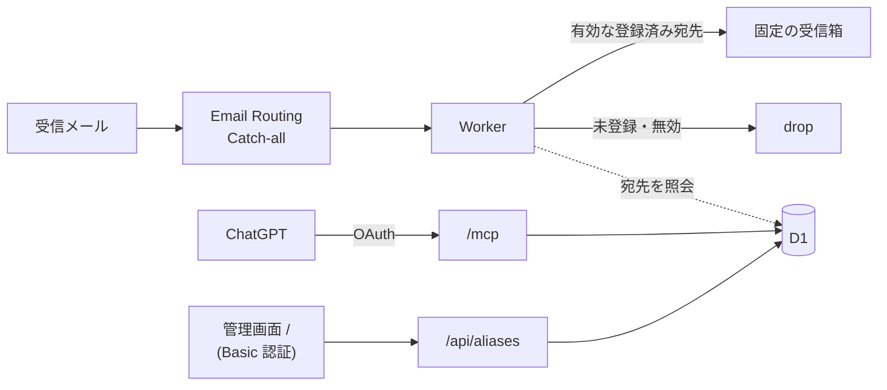

# Email Aliases

独自ドメインの Catch-all アドレス（`*@mail.example.com`）の受信許可リストを管理する、個人用の MCP サーバー。
ドメイン・表示名・テーマカラーは `app.config.ts`、デプロイ先は `deploy.config.ts` で変更できる。



Cloudflare Workers / D1 / KV（OAuth 用）/ Hono / React / Mantine / Reylo / Vite+

## エントリーポイント

Worker は `fetch`（HTTP）と `email`（Email Routing）の 2 つのハンドラーを持つ。

| 入口                    | 認証  | 内容                                             |
| ----------------------- | ----- | ------------------------------------------------ |
| `email` ハンドラー      | なし  | Catch-all で受けたメールを転送または drop        |
| `/mcp`                  | OAuth | MCP（Streamable HTTP、ステートレス）             |
| `/.well-known/oauth-*`  | なし  | OAuth のメタデータ（OAuthProvider が自動で返す） |
| `/oauth/register`       | なし  | クライアント登録（DCR）                          |
| `/oauth/token`          | なし  | トークン発行・更新                               |
| `/authorize`            | Basic | 接続承認ページ                                   |
| `/`                     | Basic | 管理画面（React SPA）                            |
| `/api/aliases`          | Basic | 管理 API（GET・POST・PATCH・DELETE）             |
| `/api/aliases/disabled` | Basic | 管理 API（PUT で有効・無効を切り替え）           |
| `/health`               | なし  | 死活確認                                         |

## MCP ツール

| ツール                 | 入力                               | 動作                                                    |
| ---------------------- | ---------------------------------- | ------------------------------------------------------- |
| `create_alias`         | `address`, `note?`, `service_url?` | 受信を許可。既存アドレスは変更しない                    |
| `list_aliases`         | `limit?`, `offset?`                | 無効なものも含めて一覧。`next_offset` で次ページ        |
| `delete_alias`         | `address`                          | 登録を削除。以後のメールを drop                         |
| `set_alias_disabled`   | `address`, `disabled`              | 転送の停止・再開。登録情報は保持                        |
| `update_alias_details` | `address`, `note?`, `service_url?` | メモ・サービス URL を編集。省略項目は保持、空文字で消去 |

- `address` は `shopping@mail.example.com` のような完全なアドレス。完全一致で判定するため `shopping+news` は別扱い。
- ローカルパートは ASCII のドット区切り（最大 64 文字）のみ。`*` は使えない。
- 転送先は全アドレス共通の `FORWARD_TO`。

## ローカル開発

Node.js 24 以降と pnpm 10 が必要。

```sh
pnpm install
cp .dev.vars.example .dev.vars   # ADMIN_PASSWORD と FORWARD_TO を設定
vp run db:migrate:local
vp run dev                       # http://localhost:5173（ユーザー名 admin）
```

```sh
vp run check            # フォーマット・Lint・型検査
vp run test             # 単体テスト
vp run test:integration # cf dev を起動する結合テスト
vp run build
```

タスクは `vite.config.ts` に定義している。`vp` が PATH にない場合は `pnpm exec vp run <タスク名>`。

### 開発メモ

- SQL は `src/aliases/queries/*.sql` に置き、Reylo が型を推論する。そのため TypeScript 7.1 Beta を固定している。
- `any`・`as`・`!` は lint で禁止。例外は Reylo の型を受け取る `src/aliases/store.ts` のみで、型の一致は `store.test-d.ts` で検査する。
- VS Code で `.sql` の import が解決できない場合は、拡張 **TypeScript 7**（`TypeScriptTeam.native-preview`）でワークスペースの TypeScript を使う。それでも駄目なら Node 24 で VS Code を起動し直す（`mise exec node@24.14.0 -- code .`）。

## 本番への配置

1. D1 と KV を作成する。

   ```sh
   pnpm exec cf auth login
   pnpm exec cf d1 create --name email-aliases
   pnpm exec cf kv namespaces create --title email-aliases-oauth
   ```

2. `app.config.ts` と `deploy.config.ts` を自分の環境に合わせて編集する。

3. マイグレーションを適用する（DB 名ではなく database ID を指定）。

   ```sh
   pnpm exec cf d1 migrations apply <database-id>
   ```

4. `.prod.vars` に本番用の値を設定してデプロイする（値は Worker Secrets としてアップロードされる）。
   公開 URL（`PUBLIC_ORIGIN`、末尾 `/` なし）もリポジトリに載せないよう、ここに置く。
   `FORWARD_TO` は Email Routing で確認済みのアドレスにする。

   ```sh
   cp .prod.vars.example .prod.vars
   vp run deploy --secrets-file .prod.vars
   ```

5. ChatGPT から接続し、使用中のアドレスを **先に** `create_alias` で登録する。

6. Email Routing で `app.mailDomain` の Catch-all の転送先をこの Worker に変更する。切り替え後、D1 にない宛先はすべて drop される。

## ChatGPT から接続

ChatGPT の MCP 接続で `https://<worker-origin>/mcp` を指定し、認証に OAuth を選ぶ。
ログイン画面でユーザー名 `admin` と `ADMIN_PASSWORD` を入力し、接続を承認する。

すべての接続を失効させるには、OAuth 用 KV を作り直して binding を切り替える（パスワード変更ではトークンは失効しない）。
